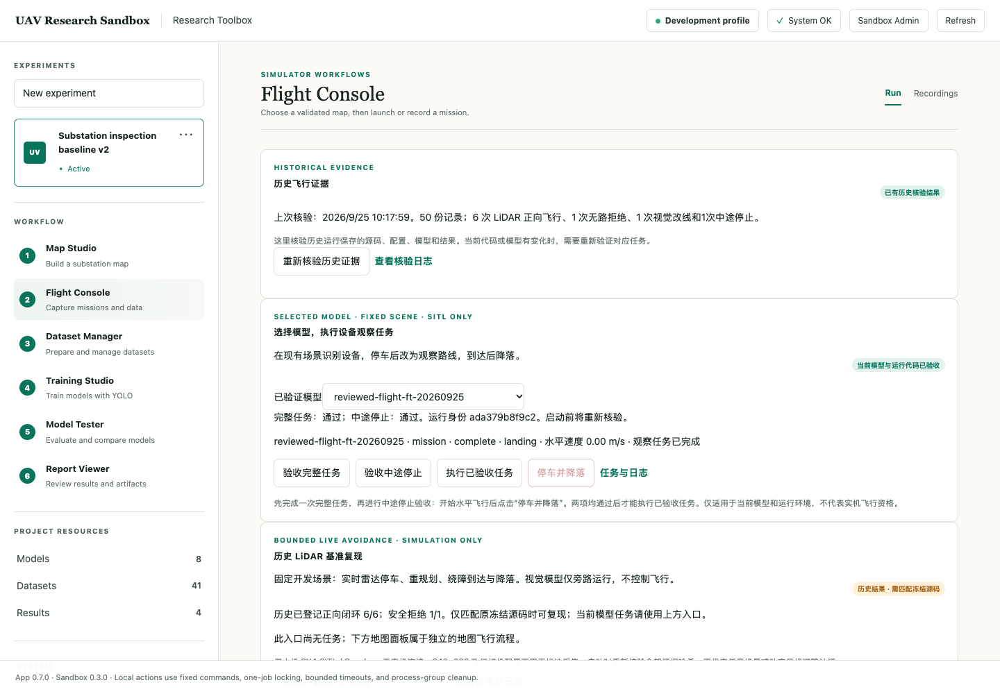

# UAV Visual Research Toolbox

Small offline workflows for substation equipment vision, with engineering case studies from PX4/Gazebo integration. The four example classes are transformer, switchgear, capacitor bank and reactor.

[中文说明](README.zh-CN.md) · [Quick start](docs/SANDBOX_QUICKSTART.md) · [Code guide](docs/CODE_GUIDE.md) · [Case studies](docs/case-studies/README.md)

## Run the offline examples

Use Python **3.11+** on macOS or Linux. From a checkout of this source snapshot:

```sh
python3 -m venv .venv
source .venv/bin/activate
python -m pip install -r requirements-offline.txt
python examples/dataset_audit/run.py --output outputs/examples/dataset-audit
python examples/prediction_comparison/run.py --output outputs/examples/prediction-comparison
python examples/receipt_check/run.py --output outputs/examples/receipt-check
```

Each output directory must be new. The commands use tracked geometric images and constructed predictions; they need no trained model, download of research assets, PX4 or Gazebo.

| Workflow | What to inspect | What it demonstrates |
| --- | --- | --- |
| Dataset audit | `outputs/examples/dataset-audit/audit.json` | Import 8 training and 4 validation images through the existing YOLO dataset audit; reject malformed boxes and duplicate images. |
| Prediction comparison | `outputs/examples/prediction-comparison/comparison.html` | Annotated images, per-class counts and metric changes on exactly the same cached inputs. Open the HTML locally. |
| Receipt check | `outputs/examples/receipt-check/tamper_check.json` | Verify the original result and reject an altered copy. This example needs only the Python standard library. |

The images are generated shapes, and the predictions are **manually constructed caches**. Their scores demonstrate matching and reporting, not equipment recognition accuracy. Dataset structure checks do not establish label correctness or independent physical sites. Receipts bind recorded bytes; they are not signatures or flight qualifications. See [example inputs and contracts](examples/README.md).

## Explore the implementation

The reusable parts are the audited data import, fixed experiment inputs, same-membership comparison and result verification. The examples call existing modules rather than introducing a second training system.

| Capability | Start reading |
| --- | --- |
| Data audit and registration | [workbench_datasets.py](src/sandbox/workbench_datasets.py) |
| Recipes and experiment receipts | [workbench_recipe.py](src/sandbox/workbench_recipe.py), [workbench_receipt.py](src/sandbox/workbench_receipt.py) |
| Detection metrics and comparison | [detection_metrics.py](src/vision/evaluation/detection_metrics.py), [workbench_comparison.py](src/sandbox/workbench_comparison.py) |
| Offline example orchestration | [offline_examples.py](src/sandbox/offline_examples.py) |
| CLI, browser UI and optional simulation | [code guide](docs/CODE_GUIDE.md) |
| Export and clean-install source identity | [source_bundle.py](src/sandbox/source_bundle.py) |

## Read the engineering cases

[Four curated case studies](docs/case-studies/README.md) retain measurements, failures, changes and remaining uncertainties:

- Source verification blocking the telemetry event loop.
- Shutdown diagnostics delaying simulator cleanup and overflowing a logging queue.
- A shared magnetic model reducing static ground heading disagreement.
- The E21 model comparison: three development seeds and a 56-frame synthetic test, including switchgear and small-object weaknesses.

Small JSON excerpts carry the original artifact hashes. Run `python3 scripts/verify_case_studies.py` to check their internal arithmetic and excerpt identities. This does not reproduce the original training or flights. Full raw logs, weights and source datasets remain external.

## Optional browser Demo

A separate deterministic range/density classifier demonstrates managed jobs, recipes and receipts. It runs with **Python 3.11+ and no packages**:

```sh
./scripts/run_sandbox_app.sh
```

Open [localhost:8765](http://127.0.0.1:8765/#results/acceptance), then **Acceptance → Demo classifier → Create recipe and run**. Stop the server with `Ctrl-C`. A terminal-only alternative is in the [quick start](docs/SANDBOX_QUICKSTART.md).

<details>
<summary>Historical desktop workspace</summary>



Actual September 25, 2026 capture. The models, datasets and qualified-flight receipts shown are author-local research assets and are not bundled. The browser workspace includes map editing, collection, label review, training, model testing and reports. Its full research setup is described in [Research preview](docs/RESEARCH_PREVIEW.md).

</details>

## Dependencies and scope

| Task | Install or supply | Scope |
| --- | --- | --- |
| Demo / receipt example | Python 3.11+ only | Deterministic local workflow |
| Dataset audit / cached comparison | `requirements-offline.txt` (Pillow, PyYAML) | No training or inference |
| Portable core tests | Python 3.12–3.14, `requirements-test.txt` including pytest | No author datasets, weights, PX4 or Gazebo |
| Real visual training / inference | Core + `requirements-ml.txt`, reviewed data and relevant weights | Existing image inference uses Ultralytics; ONNX Runtime alone is insufficient |
| Native integration / SITL | Matching external PX4/Gazebo, plugins, inputs and new runtime qualification | Experimental, platform dependent |

This **research-toolbox-20261102 source snapshot** uses the September 25 public baseline plus selected publication changes and October case excerpts. It does not merge the full later local flight-control worktree. Full autonomy expansion is paused; the public direction is offline research workflows and documented engineering results. No real-aircraft or real-substation readiness is claimed.

The older **v0.6.4 macOS prerelease** belongs to its own commit. This source snapshot has no new desktop installer. See [publication scope](docs/PUBLICATION_SCOPE.md), [release notes](docs/RELEASE_SNAPSHOT_20261102.md) and [historical index](docs/HISTORY_INDEX.md).

## Develop and distribute

```sh
python -m pip install -r requirements-test.txt
python scripts/run_tests.py --suite core --report outputs/core-tests.json
python examples/generate_fixtures.py --check
python scripts/verify_case_studies.py
python scripts/export_source.py --output dist/research-toolbox-source.zip
```

The test runner collects unittest classes, pytest functions and parameterized tests. A requested module with zero tests or a skipped required check fails acceptance. Research/native/SITL groups are explicit opt-ins; see [validation](docs/VALIDATION.md) and [contributing](CONTRIBUTING.md).

The source exporter and clean-install gate share a tracked-file inventory. The ZIP includes per-file hashes and source provenance; it excludes research datasets, weights, environments and generated runs. See [distribution details](docs/PUBLICATION_SCOPE.md).

[GitHub main CI](https://github.com/Xieyizhou/substation-uav-ml-research/actions/workflows/ci.yml) describes the published main branch. Local candidate validation and the configured CI matrix are distinguished in the release notes; a historical green run does not verify this candidate.

## License

Project code and generated format fixtures use [MIT](LICENSE). See [provenance](PROVENANCE.md) and [third-party notices](THIRD_PARTY_NOTICES.md). External packages and assets retain their terms, including the optional Ultralytics AGPL-3.0 stack.
